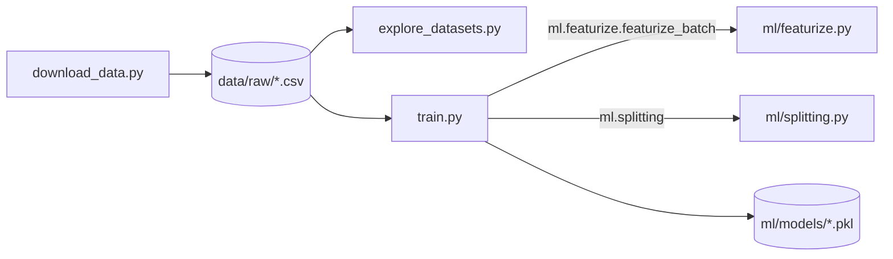
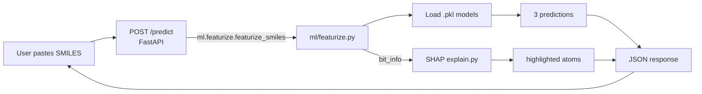

# Architecture

Status snapshot of the ADMET Prediction app. Updated as each build step lands.

## What this app does

A stateless web app: a user pastes a molecule's SMILES string and gets back
predictions for three properties that matter in early drug discovery —
**solubility**, **blood-brain barrier (BBB) permeability**, and
**toxicity** — plus a SHAP-based visual explanation highlighting which part
of the molecule drove each prediction. No accounts, no history, no
database. Every prediction is computed fresh, from scratch, in one request.

## Build order and current status

| # | Step | Status |
|---|---|---|
| 1 | RDKit basics (SMILES → fingerprint → bit-to-atom mapping) | done (folded into Step 3, see below) |
| 2 | Download & explore ESOL, BBBP, Tox21 datasets | done |
| 3 | Shared featurization function (`featurize.py`) | done |
| 4 | Train 3 baseline Random Forest models, benchmark, save as `.pkl` | done |
| 5 | SHAP explainability (`explain.py`) | done |
| 6 | FastAPI backend — stateless `POST /predict` | done |
| 7 | React frontend — SMILES input, molecule viewer, prediction cards | done |
| 8 | Integrate, test, Dockerize, write README | done |

## Project structure

```
ADMET Prediction/
├── requirements.txt        # Python deps, grouped by the step that introduced them
├── architecture.md         # this file
├── .venv/                  # local virtual environment (not committed)
├── api/
│   ├── __init__.py
│   └── main.py              # Step 6: the whole backend -- one POST /predict endpoint
├── data/
│   └── raw/                 # downloaded MoleculeNet CSVs (fetched, not authored — gitignore candidate)
│       ├── esol.csv
│       ├── bbbp.csv
│       ├── tox21.csv.gz     # original gzipped download, kept for provenance
│       └── tox21.csv        # decompressed, so all 3 datasets load identically
├── ml/                      # shared code — imported by training AND (later) the API
│   ├── featurize.py         # SMILES -> fingerprint + bit-to-atom map (ONE function, used everywhere)
│   ├── splitting.py         # train/test split strategies (training-only, not used at inference)
│   ├── explain.py            # SHAP TreeExplainer wrapper -> per-atom signed contribution scores
│   ├── depict.py             # Step 7: 2D atom coordinates + bonds for the frontend viewer
│   └── models/               # trained models, saved as .pkl (gitignore candidate — see note below)
│       ├── esol_rf.pkl       # RandomForestRegressor
│       ├── bbbp_rf.pkl       # RandomForestClassifier
│       └── tox21_rf.pkl      # dict[str, RandomForestClassifier], one per assay (12 models)
├── tests/                   # Step 8: pytest suite (test_featurize, test_explain, test_api)
├── Dockerfile.backend       # Step 8: python:3.13-slim + api/ + ml/ + the 3 CSVs read at startup
├── docker-compose.yml       # Step 8: backend + frontend (nginx on :8080, proxies /predict)
├── requirements-dev.txt     # pytest, httpx
├── README.md
├── scripts/                 # one-off / run-once scripts, not imported by the app itself
│   ├── download_data.py      # Step 2: fetch the 3 raw datasets
│   ├── explore_datasets.py   # Step 2: sanity-check row counts, targets, missing data, SMILES validity
│   └── train.py               # Step 4: featurize -> split -> train -> evaluate -> save, all 3 models
└── frontend/                # Step 7: React (Vite) app -- SMILES input, molecule viewer, prediction cards
    ├── Dockerfile           # Step 8: multi-stage, Vite build -> nginx
    ├── nginx.conf           # Step 8: serves the build, proxies /predict to the backend
    └── src/
        ├── api.js             # POST /predict wrapper
        ├── App.jsx             # top-level state: SMILES input, result, which property is "active"
        ├── MoleculeViewer.jsx  # renders structure.atoms/bonds as SVG, colored by the active property's atom_contributions
        └── PredictionCard.jsx  # one clickable summary card (Solubility / BBBP / Toxicity)
```

## Data flow

**Right now (offline, run manually via scripts) — this is how the models above got built:**



**Now that Step 6 exists — the live request flow:**



The key property both diagrams share: **`ml/featurize.py` is the single
point every path goes through.** Training and (eventually) inference call
the exact same function, so the model is never scored on inputs computed a
different way than it was trained on ("train/serve skew").

## Key design decisions so far

**One shared featurization function, never duplicated (Step 3).**
`ml/featurize.py` exposes `featurize_smiles()` (one molecule) and
`featurize_batch()` (many, built on top of the same function — no separate
logic). It converts a SMILES string into a 2048-bit Morgan/ECFP fingerprint
(radius 2 — the "ECFP4" standard used in the MoleculeNet baselines we
benchmark against) using RDKit's current `rdFingerprintGenerator` API. It
also captures `bit_info` — which atom(s) set each bit — as a side effect,
unused by training but needed later by Step 5's SHAP explanations, so
explainability never needs a second, parallel featurization path.

**Dataset-specific train/test splits (Step 4), matching the original
MoleculeNet paper (Wu et al. 2018) per dataset:**
- **BBBP** uses a *scaffold split* (`ml/splitting.py`): molecules are
  grouped by Bemis-Murcko scaffold (core ring system) and each group is
  kept entirely on one side of the split, so the model can't pass by
  recognizing near-duplicates it already saw in training. This is
  deliberately the harder test.
- **ESOL** and **Tox21** use a plain random split, also matching the paper.
- Using a different split than the paper would make the benchmark numbers
  below meaningless — this was a deliberate constraint, not a default.

**Tox21 trains 12 separate models, one per toxicity assay,** because each
assay independently has missing labels (7–26% missing, found in Step 2).
One shared 80/20 split is computed once over all molecules; each of the 12
sub-models then trains only on the rows that have a non-missing label for
that specific assay, so no molecule is wasted just for lacking a label on
some other assay.

**Model size was actively tuned, not left at a default.** The initial
`n_estimators=500` produced 560MB of `.pkl` files (Tox21 alone: 502MB,
since it's 12 forests). A quick benchmark on one task showed 100 trees
performed equally well (0.806 vs 0.794 AUROC) at ~1/5th the size, so
`n_estimators=100` is used everywhere. Final total: **112MB**. This matters
for Step 8 (Docker image size) and Step 6 (backend memory/startup time).

**Model choice: Random Forest**, specifically because it pairs with SHAP's
`TreeExplainer` in Step 5 — fast, *exact* SHAP values for tree ensembles,
unlike the slower approximate methods other model types would need.

**SHAP explanations reuse Step 3's `bit_info`, never a second way of
reading the molecule (Step 5).** `ml/explain.py` takes a trained model plus
an already-featurized molecule and returns one signed contribution score
per atom: positive means that atom's substructure pushed the prediction up,
negative means it pushed the prediction down. Only fingerprint bits that
are actually "on" for this molecule have an atom to attribute to (RDKit's
`bit_info` only records bits it saw fire), so off-bits are automatically
irrelevant to the highlighting. Each on-bit's score is attributed to the
one atom at the center of the substructure that set it — a deliberate
simplification versus crediting every atom in that substructure's
neighborhood, matching common practice in published RDKit/SHAP
fingerprint-interpretation examples and kept simple on purpose.

**Real bug found and worked around: SHAP's default TreeExplainer mode
doesn't work with this project's scikit-learn version.** TreeExplainer's
default `feature_perturbation="tree_path_dependent"` failed its own
built-in additivity check on real predictions — the attributed
contributions did not sum anywhere close to the model's actual output (off
by double digits, not a rounding error). Switching to
`feature_perturbation="interventional"` with an explicit background sample
of ~100 real training molecules fixes this, and every explanation now
reconstructs the model's real prediction to within 1e-6 (verified in
`tests/test_explain.py` for all three models). This is why
`make_explainer()` always requires a background sample — it's not optional
tuning, it's required for correct output on this stack.

**Models and SHAP explainers are built once at server startup, not per
request (Step 6).** `api/main.py` loads all three `.pkl` files and builds
all 14 SHAP explainers (1 ESOL + 1 BBBP + 12 Tox21) in a FastAPI `lifespan`
handler that runs once when the process boots, storing them in a plain
module-level dict. Each `POST /predict` request then only does per-molecule
work: featurize once, call each model's `.predict()`/`.predict_proba()`,
and run SHAP against that one fingerprint. This keeps request latency
independent of the fixed cost of loading 112MB of models and their
background samples — a cost that has nothing to do with which molecule a
user submits. Local startup takes on the order of tens of seconds (visible
during testing), almost entirely from building the 12 Tox21 explainers;
this matters for Step 8's container startup time / readiness checks.

**One shared background sample per dataset, not one per Tox21 task.** All
12 Tox21 sub-models were trained on the same underlying molecules (just
different per-task labels), so one 100-molecule background sample from
`tox21.csv` is reused to build all 12 explainers, instead of resampling
12 times for no benefit.

**CORS is wide open (`allow_origins=["*"]`), deliberately.** The backend
has no cookies, auth, or session state of any kind — a permissive origin
policy carries no meaningful risk here and is what lets a browser-based
frontend call the API at all during Step 7. Worth revisiting only if this
API ever gains state or credentials in the future.

**Response shape:** one JSON object with `solubility`, `bbbp`, and a
`tox21` object keyed by assay name (e.g. `"NR-AR"`), each holding
`prediction`, `base_value`, and `atom_contributions` (an
`{atom_index: signed_score}` map, only for atoms in the submitted
molecule). The response echoes back the exact SMILES the user submitted,
byte-for-byte — deliberately NOT RDKit's canonicalized form. RDKit's
canonical SMILES can reorder atoms relative to the input string, and
`atom_contributions`' indices are keyed to the *original* string's parse
order; if the frontend needs to re-parse the SMILES (e.g. to render/
highlight the molecule), it must re-parse this exact string for the atom
indices to still line up with the backend's. Invalid SMILES return `422`
with a plain-language error message instead of a stack trace.

**All chemistry stays in the backend, including 2D layout (Step 7).**
Drawing a molecule needs each atom's 2D position and its bonds. Rather than
add an RDKit-in-the-browser library (RDKit.js/WASM) to the frontend, the
backend computes the layout once via a new `ml/depict.py` (`compute_layout`,
using RDKit's `Compute2DCoords`) and sends it as plain JSON —
`structure.atoms` (index, element, x, y) and `structure.bonds` (begin_atom,
end_atom, order) — alongside the existing prediction fields. The frontend
(`MoleculeViewer.jsx`) draws it with ordinary SVG: circles for atoms, lines
for bonds (doubled/tripled for bond order), colored by whichever property's
`atom_contributions` is currently selected. This keeps the "one place does
the chemistry" principle from Step 3 intact and means the frontend needed
no new dependency beyond React itself.

**Highlight color encodes two things separately: hue for direction, opacity
for strength.** Each atom's SHAP contribution is a signed number. Sign
picks one of two fixed colors (blue = pushed the prediction up, red =
pushed it down — a validated colorblind-safe diverging pair), and
magnitude (normalized against the strongest contribution in that
molecule) sets the circle's opacity. A visible legend always accompanies
the highlighting so direction is never conveyed by color alone. Atoms
with a near-zero contribution get no highlight at all, so the eye is
drawn to what actually mattered.

**Clicking a prediction card switches which property's explanation is
shown**, rather than showing all three highlight layers at once (which
would just look like noise on top of the same molecule). Toxicity has 12
sub-scores, so its card additionally holds a dropdown to pick which Tox21
assay to explain; it defaults to whichever assay scored highest (most
concerning first), not an arbitrary or alphabetical one.

**Verified in a real browser, not just by reading the code:** ran the app
end-to-end with Playwright against the live backend — submitted a
molecule, confirmed the structure renders with correct bonds, confirmed
clicking each card actually re-colors the atoms (screenshots compared
before/after), confirmed the Tox21 dropdown swaps both the shown
percentage and the highlighting, and confirmed an invalid SMILES shows a
clear inline error instead of breaking the page.

## Benchmark results (Step 4)

| Dataset | Metric | Our RF | Closest verified published reference | Split |
|---|---|---|---|---|
| ESOL | RMSE (lower better) | **1.135** | 0.99 (XGBoost, ECFP); 0.58 (MPNN, deep) | random |
| BBBP | AUROC (higher better) | **0.872** | 0.729 (Kernel SVM, ECFP) | scaffold |
| Tox21 | mean AUROC (higher better) | **0.805** | 0.822 (Kernel SVM, ECFP); 0.829 (Graph Conv, deep) | random |

Reference numbers were fetched directly from the original MoleculeNet paper
(Wu et al. 2018, *Chemical Science*), not recalled from memory. Important
honesty caveat: the paper's own summary table does **not** publish a
Random-Forest-specific score for these three datasets — only the best
"shallow" method per dataset is available as a verified reference. So:
- **BBBP** clearly beats its reference under the same scaffold-split
  protocol — a real result.
- **Tox21** is close behind its reference under the same random-split
  protocol.
- **ESOL** is behind its reference; plausible cause is gradient-boosted
  XGBoost typically outperforming plain RF on this small (1128-molecule)
  regression set.

## Dependencies so far (`requirements.txt`)

```
rdkit         # cheminformatics: SMILES parsing, fingerprints, scaffolds
pandas, numpy # data handling
scikit-learn  # RandomForestRegressor / RandomForestClassifier
joblib        # saving/loading trained models as .pkl
shap          # TreeExplainer -- per-atom prediction attribution
fastapi, uvicorn  # Step 6: the backend web framework + server
```

`frontend/package.json` (Step 7): a standard Vite + React scaffold, no
extra UI/state/charting libraries added — the app is a single form, one
result state, and hand-written SVG, so nothing beyond React itself earns
its keep yet.

## How to run what exists

```bash
# from the project root, using the project's virtual environment
.venv/Scripts/python.exe scripts/download_data.py     # fetch raw datasets (skips if already present)
.venv/Scripts/python.exe scripts/explore_datasets.py  # print dataset sanity checks
.venv/Scripts/python.exe -m scripts.train              # train + evaluate + save all 3 models
.venv/Scripts/python.exe -m pytest tests                # run the test suite (~25s, loads all models)

# backend (from the project root) -- serves on http://localhost:8000
.venv/Scripts/python.exe -m uvicorn api.main:app --reload --port 8000

# frontend (from frontend/), in a second terminal -- serves on http://localhost:5173
npm install   # first time only
npm run dev
```

## Not yet decided / open items for later steps

- Whether `data/raw/` and `ml/models/*.pkl` should be committed to git or
  regenerated via script (given `tox21_rf.pkl` alone is ~101MB). Currently the
  Docker image bakes the `.pkl` files and 3 CSVs in, so a build needs them on disk.


## Step 8: testing, containers, deployment decisions

**Tests replaced the ad-hoc scripts.** `tests/` holds 14 pytest tests: the
featurizer (shape, determinism, invalid SMILES, `bit_info` keys are exactly
the on-bits, batch matches single), SHAP additivity against all three model
types (the Step 5 bug, now a permanent regression guard), and the API (valid
request, 422 on invalid or missing input, input SMILES echoed unchanged,
contribution indices refer to real atoms, and same-input-same-output across
interleaved requests, which checks statelessness).

**Dependencies are pinned exactly.** Pickled scikit-learn models are not
guaranteed to load on other versions, and the models were trained on
scikit-learn 1.9.1, so `requirements.txt` now uses `==` pins. Verified: the
container returns the same solubility prediction (-2.908) as the local venv.

**Two containers, one origin.** The frontend image is a multi-stage build
(Vite build, then nginx). nginx serves the static bundle and proxies
`/predict` to the backend, so the browser talks to a single origin and the
hardcoded `localhost:8000` is gone (`VITE_API_URL` is set empty at build
time; the built bundle was checked for leftover `localhost:8000`, none).

**Startup time is handled by a health check, not hidden.** The backend's
~20s explainer build is covered by a Docker `HEALTHCHECK` with a 90s start
period, and compose only starts the frontend once the backend is healthy.

**Image size:** backend 1.4GB (rdkit, scikit-learn, shap/numba/llvmlite and
112MB of models), frontend 94MB. Not optimized; a possible later saving is
dropping unused shap dependencies, but nothing is broken by the size.

**Not done:** the containerized UI was verified through nginx with `curl`
(predict, 422, static page, bundle contents) rather than re-driven in a
browser; the UI code itself is unchanged from the Step 7 browser check.
